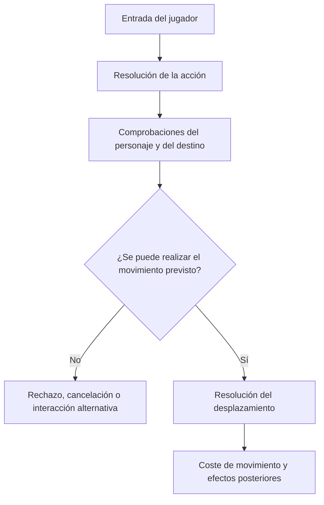
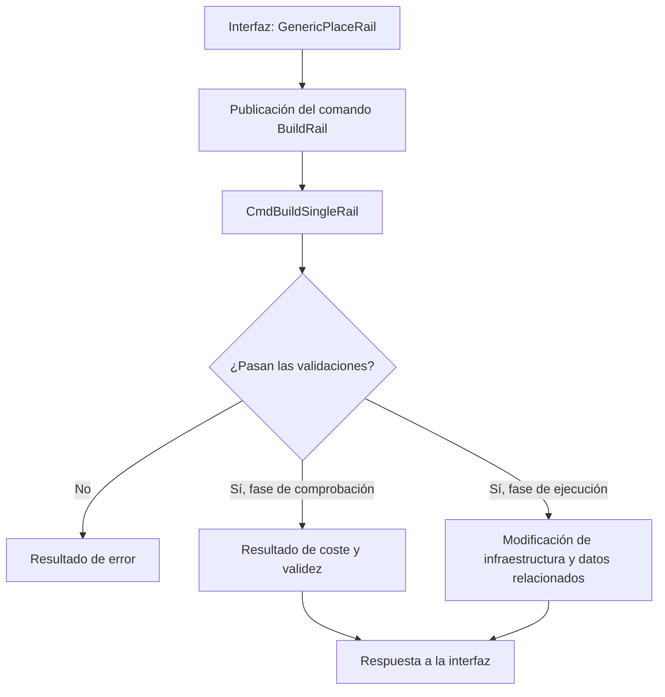
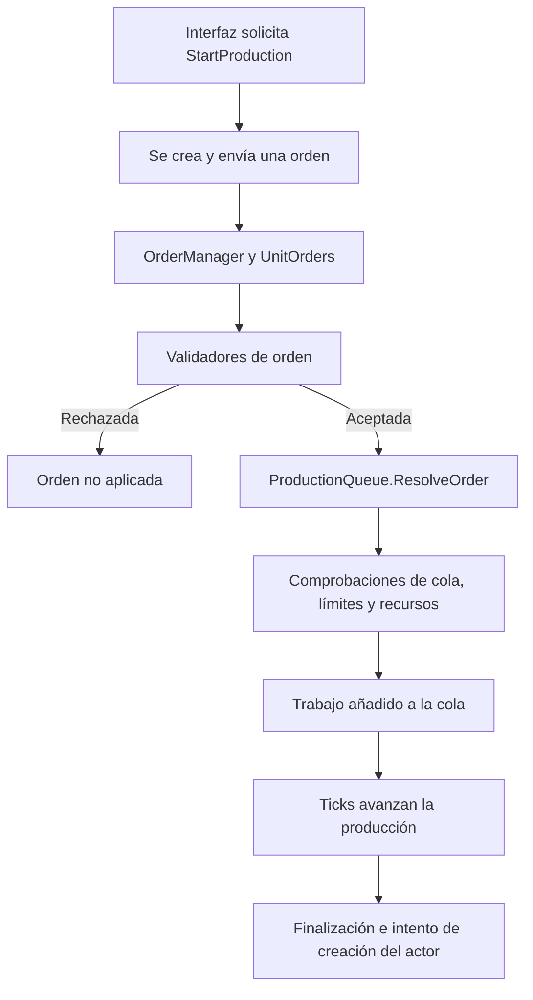

# 02-A — Auditoría técnica de proyectos de referencia

> **Estado:** preliminar · Investigación documental, no auditoría de ejecución  
> **Propósito:** registrar patrones de implementación observados en proyectos reales para orientar el futuro diseño del videojuego experimental.  
> **Regla de rigor:** distinguir siempre entre evidencia directa en código, cobertura de pruebas, hipótesis de diseño y cuestiones pendientes.

## 1. Relación con los documentos base

Este documento complementa, pero no reemplaza, los tres documentos conceptuales existentes:

- **01-A — Catálogo de géneros y formas de jugar**
- **01-B — Biblioteca de mecánicas**
- **01-C — Casos de estudio profundos**

Los documentos 01 describen el espacio de diseño y sus ejemplos. Este 02-A registra cómo ciertos sistemas concretos se implementan en código. La integración cruzada con los tres documentos queda pendiente hasta completar las trazas técnicas.

No se elige todavía motor, lenguaje, arquitectura definitiva ni estrategia de implementación.

## 2. Alcance y método

Se seleccionaron tres proyectos de código abierto que presentan problemas de simulación distintos:

1. **Cataclysm: Dark Days Ahead (DDA):** simulación contextual de acciones y movimiento.
2. **OpenTTD:** comandos de construcción y modificación del mundo.
3. **OpenRA:** procesamiento de órdenes y producción de unidades.

Método aplicado:
- Inspección de archivos fuente y pruebas localizadas.
- Reconstrucción de recorridos funcionales a partir de llamadas y tipos visibles.
- Registro de revisiones de código usadas para que los enlaces no dependan solo de ramas móviles.
- Separación explícita entre comportamiento implementado, pruebas encontradas y deducciones.
- No se afirma que el código haya sido compilado, ejecutado, perfilado ni sometido a pruebas propias.

### 2.1 Revisiones de trabajo

| Proyecto | Revisión usada | Repositorio |
|---|---|---|
| Cataclysm DDA | `0947a14bab4cf6b3243568cb78ac3e6a2a108e1d` | [CleverRaven/Cataclysm-DDA](https://github.com/CleverRaven/Cataclysm-DDA) |
| OpenTTD | `d48d693d7ff09b643846e23a5f033cf3582ab27f` | [OpenTTD/OpenTTD](https://github.com/OpenTTD/OpenTTD) |
| OpenRA | `e7e9e4ad270221d7fb9725b348c75504d48c1ebd` | [OpenRA/OpenRA](https://github.com/OpenRA/OpenRA) |

Estos identificadores son las referencias de trabajo de la inspección previa. Antes de declarar la auditoría cerrada, conviene verificar de nuevo que cada SHA corresponde a la revisión deseada y que todos los enlaces de archivos usan exactamente esa revisión.

---

## 3. Cataclysm DDA — Movimiento contextual

### 3.1 Archivos relevantes

- [`src/handle_action.cpp` en la revisión inspeccionada](https://github.com/CleverRaven/Cataclysm-DDA/blob/0947a14bab4cf6b3243568cb78ac3e6a2a108e1d/src/handle_action.cpp)
- [`src/avatar_action.cpp` en la revisión inspeccionada](https://github.com/CleverRaven/Cataclysm-DDA/blob/0947a14bab4cf6b3243568cb78ac3e6a2a108e1d/src/avatar_action.cpp)
- [`tests/move_cost_test.cpp` en la revisión inspeccionada](https://github.com/CleverRaven/Cataclysm-DDA/blob/0947a14bab4cf6b3243568cb78ac3e6a2a108e1d/tests/move_cost_test.cpp)
- [`src/game.h` en la rama actual](https://github.com/CleverRaven/Cataclysm-DDA/blob/master/src/game.h)
- [`src/game.cpp` en la rama actual](https://github.com/CleverRaven/Cataclysm-DDA/blob/master/src/game.cpp)
- [`src/savegame_json.cpp` en la rama actual](https://github.com/CleverRaven/Cataclysm-DDA/blob/master/src/savegame_json.cpp)
- [`doc/MODDING.md` en la rama actual](https://github.com/CleverRaven/Cataclysm-DDA/blob/master/doc/MODDING.md)

> Los enlaces que apuntan a `master` son referencias exploratorias móviles; no deben mezclarse con evidencia de la revisión fijada sin verificar el mismo contenido en el SHA.

### 3.2 Hallazgo preliminar

El movimiento no se reduce a sumar una dirección a la posición. La acción de movimiento consulta el contexto del personaje y del mundo, y puede relacionarse con estados del personaje, terreno, criaturas, restricciones y efectos secundarios.

Flujo conceptual preliminar:

El diagrama es una síntesis conceptual, no un trazado exhaustivo de todas las ramas del código. Queda pendiente confirmar en una única revisión el orden exacto de todas las comprobaciones, mutaciones de posición, consumo de puntos de movimiento y efectos posteriores.

### 3.3 Pruebas encontradas

En `tests/move_cost_test.cpp` hay pruebas de costes de movimiento en escenarios específicos y comprobaciones relacionadas con `avatar_action::move(...)` y los puntos de movimiento. Entre los casos inspeccionados aparecen valores como 100 para un coste base normalizado, 300 en un escenario con el personaje derribado, 116 sin calzado, y valores de patines dependientes del terreno (27 en pavimento y 167 en hierba en un escenario de carrera).

Estos valores pertenecen a los casos de prueba concretos; **no son constantes universales** del sistema. Esta prueba no demuestra por sí sola que todas las ramas de colisión, interacción o movimiento estén cubiertas.

### 3.4 Implicaciones para el proyecto

- Una acción de alto nivel puede coordinar estado, geometría, entidades, combate y tiempo.
- Conviene distinguir la intención de moverse de la resolución efectiva del desplazamiento.
- El coste de una acción debería analizarse por separado de la decisión de si la acción es válida.
- Una API genérica de movimiento no debería ocultar las reglas contextuales que necesita cada tipo de entidad.

### 3.5 Pendientes

- [ ] Confirmar SHA completo y enlaces de todos los archivos.
- [ ] Cerrar el recorrido de mutación de posición y efectos posteriores.
- [ ] Inspeccionar pruebas de obstáculos, criaturas, rampas y restricciones.
- [ ] Distinguir pruebas unitarias de coste de pruebas integradas de movimiento.
- [ ] Trazar serialización y restauración del estado relevante en la misma revisión.

---

## 4. OpenTTD — Comandos de construcción

### 4.1 Archivos relevantes

- [`src/rail_gui.cpp`](https://github.com/OpenTTD/OpenTTD/blob/d48d693d7ff09b643846e23a5f033cf3582ab27f/src/rail_gui.cpp)
- [`src/rail_cmd.cpp`](https://github.com/OpenTTD/OpenTTD/blob/d48d693d7ff09b643846e23a5f033cf3582ab27f/src/rail_cmd.cpp)
- [`src/command.cpp`](https://github.com/OpenTTD/OpenTTD/blob/d48d693d7ff09b643846e23a5f033cf3582ab27f/src/command.cpp)
- [`src/command_func.h`](https://github.com/OpenTTD/OpenTTD/blob/d48d693d7ff09b643846e23a5f033cf3582ab27f/src/command_func.h)
- [`CMakeLists.txt`](https://github.com/OpenTTD/OpenTTD/blob/master/CMakeLists.txt)

Los enlaces a los tres archivos de implementación usan la revisión de trabajo fijada. El enlace a `CMakeLists.txt` es exploratorio y móvil.

### 4.2 Hallazgo preliminar

La interfaz de construcción solicita la operación a través del sistema de comandos. La función `GenericPlaceRail()` publica una orden de construcción; `CmdBuildSingleRail()` centraliza reglas de validación y ejecución para el tramo de vía.

Entre las condiciones revisadas están propiedad, tipo y combinación de vías, pendiente, ocupación por vehículos, señales y obstáculos. Las modificaciones del mundo están condicionadas por `flags.Test(DoCommandFlag::Execute)` en las rutas correspondientes, separando comprobación y ejecución.

El diagrama resume el patrón y no pretende describir cada variante de ejecución, llamada anidada o resultado del sistema de comandos.

### 4.3 Implicaciones para el proyecto

- La interfaz puede expresar una intención sin duplicar todas las reglas del mundo.
- La lógica del comando puede actuar como autoridad sobre la validez de una operación.
- Un resultado explícito facilita comunicar éxito, coste o error a la interfaz.
- Separar comprobación y ejecución ayuda a reducir modificaciones accidentales durante consultas de validez.

Posible aplicación futura: construcción, transformación, comercio o interacción con objetos podrían usar operaciones explícitas. Antes de generalizar este patrón, habrá que evaluar si diferentes géneros comparten suficiente semántica para usar el mismo contrato.

### 4.4 Pruebas y pendientes

Se localizó infraestructura de pruebas y regresión en el repositorio, pero la búsqueda preliminar no identificó una prueba que cubra de extremo a extremo la construcción de una vía desde la interfaz hasta la modificación del mundo. Esto **no demuestra que tal prueba no exista**; significa que todavía no se localizó.

- [ ] Verificar SHA y enlaces de archivos de pruebas.
- [ ] Completar la ruta de publicación, ejecución y retorno del resultado.
- [ ] Buscar pruebas específicas de comandos de construcción de vía.
- [ ] Identificar pruebas de rechazo por propiedad, pendiente, ocupación y señales.
- [ ] Seguir el estado modificado hasta los mecanismos de guardado/carga.

---

## 5. OpenRA — Órdenes y cola de producción

### 5.1 Archivos relevantes

- [`OpenRA.Game/Network/Order.cs`](https://github.com/OpenRA/OpenRA/blob/e7e9e4ad270221d7fb9725b348c75504d48c1ebd/OpenRA.Game/Network/Order.cs)
- [`OpenRA.Game/Network/OrderManager.cs`](https://github.com/OpenRA/OpenRA/blob/e7e9e4ad270221d7fb9725b348c75504d48c1ebd/OpenRA.Game/Network/OrderManager.cs)
- [`OpenRA.Game/Network/UnitOrders.cs`](https://github.com/OpenRA/OpenRA/blob/e7e9e4ad270221d7fb9725b348c75504d48c1ebd/OpenRA.Game/Network/UnitOrders.cs)
- [`OpenRA.Game/World.cs`](https://github.com/OpenRA/OpenRA/blob/e7e9e4ad270221d7fb9725b348c75504d48c1ebd/OpenRA.Game/World.cs)
- [`OpenRA.Mods.Common/Traits/Player/ProductionQueue.cs`](https://github.com/OpenRA/OpenRA/blob/e7e9e4ad270221d7fb9725b348c75504d48c1ebd/OpenRA.Mods.Common/Traits/Player/ProductionQueue.cs)
- [`OpenRA.Mods.Common/Traits/World/ValidateOrder.cs`](https://github.com/OpenRA/OpenRA/blob/e7e9e4ad270221d7fb9725b348c75504d48c1ebd/OpenRA.Mods.Common/Traits/World/ValidateOrder.cs)

### 5.2 Hallazgo preliminar

La orden se procesa mediante `OrderManager` y `UnitOrders`. La resolución comprueba si el sujeto sigue siendo válido y si los validadores aceptan la orden; entonces la orden se deriva al actor correspondiente. `ProductionQueue.ResolveOrder()` procesa órdenes de producción y verifica cola, elemento construible, límites y condiciones de recursos según la configuración. El tick de la cola avanza el elemento en curso cuando no está pausado y hay producción habilitada.

Flujo conceptual:

Queda pendiente cerrar la ruta desde el control de interfaz exacto que crea la orden, así como la secuencia completa de finalización y creación para cada clase de producto.

### 5.3 Sincronización no equivale a persistencia

Que `ProductionQueue` implemente `ISync` no demuestra por sí solo que el estado de la cola se serialice y restaure en una partida guardada. Debe rastrearse la ruta concreta de guardado/carga y las interfaces o mecanismos de datos usados para ello.

| Concepto | Evidencia que hace falta |
|---|---|
| Orden procesada | Ruta de creación, validación y aplicación de la orden |
| Sincronización | Estado o hash usado para detectar divergencias entre simulaciones |
| Guardado | Código que escribe el estado de la cola |
| Restauración | Código que reconstruye la cola al cargar |
| Cobertura de pruebas | Test que verifica el comportamiento relevante |

### 5.4 Implicaciones para el proyecto

- Las órdenes separan intención de aplicación.
- Los validadores permiten rechazar acciones antes de alterar el estado.
- Una cola representa trabajo pendiente y progreso temporal, no solo una animación.
- Completar el tiempo de producción y lograr colocar la unidad en el mundo son estados distintos.
- Sincronización, serialización y restauración deben tratarse como responsabilidades separadas.

### 5.5 Pendientes

- [ ] Encontrar el origen exacto de la orden en la interfaz de producción.
- [ ] Trazar la finalización y la creación de actores para unidades y edificios.
- [ ] Rastrear la serialización y restauración real de la cola.
- [ ] Buscar pruebas de producción, bloqueo y guardado/carga.
- [ ] Verificar que la revisión fijada coincide con todas las rutas citadas.

---

## 6. Comparación transversal

| Dimensión | Cataclysm DDA | OpenTTD | OpenRA |
|---|---|---|---|
| Operación examinada | Movimiento contextual | Construcción de vías | Producción de unidades |
| Complejidad dominante | Estado del personaje y entorno | Validación de reglas y modificación del mapa | Órdenes, colas y progresión temporal |
| Frontera de decisión | Acción y movimiento | Sistema de comandos | Procesamiento de órdenes y traits |
| Costes/restricciones | Tiempo de movimiento, estados y terreno | Propiedad, geometría, ocupación y coste | Recursos, requisitos y límites |
| Pruebas específicas localizadas | Pruebas de costes; cobertura global incompleta | Infraestructura general; falta localizar test end-to-end | Falta localizar test end-to-end |
| Persistencia | Código de serialización localizado; ruta completa pendiente | Pendiente de trazar para la operación estudiada | Persistencia de la cola pendiente de confirmar |

### 6.1 Hipótesis de diseño, todavía no decisiones

1. El proyecto probablemente necesitará más de un patrón de ejecución de reglas.
2. Conviene distinguir intención, validación, mutación del estado y efectos posteriores.
3. Las mecánicas que comparten una interfaz visible no necesariamente comparten semántica interna.
4. Los subsistemas temporales —colas, turnos, acciones con coste, simulación continua— deben explicitar sus contratos.
5. Persistencia, sincronización y pruebas necesitan estrategias verificables por separado.

Estas hipótesis deberán contrastarse con otros proyectos y con los requisitos concretos del videojuego experimental.

---

## 7. Registro de evidencia

Usar estas categorías en las siguientes iteraciones:

- **Confirmado en código:** existe una ruta o condición visible en una revisión concreta.
- **Prueba localizada:** existe un test identificado; documentar qué afirma realmente.
- **Parcial:** se verificó una parte del recorrido, pero faltan ramas o componentes.
- **Hipótesis:** posible patrón transferible a nuestro proyecto, aún sin validar.
- **Pendiente:** evidencia que aún debe buscarse.
- **No encontrado:** no se localizó durante la búsqueda realizada; no equivale a afirmar que no existe.

## 8. Próxima iteración de investigación

Orden recomendado:

1. **Cataclysm DDA:** cerrar el orden de comprobaciones, coste, mutación de posición y efectos posteriores; ampliar la búsqueda de pruebas.
2. **OpenTTD:** cerrar publicación y ejecución de comandos, retorno de resultados, tests de construcción y persistencia del estado relevante.
3. **OpenRA:** rastrear UI → orden → validación → cola → finalización → creación; localizar serialización, restauración y tests.
4. Verificar SHA y permalinks antes de cerrar cada apartado.
5. Contrastar los hallazgos con 01-A, 01-B y 01-C, señalando confirmaciones, matices y contradicciones.
6. Solo después preparar una matriz de decisiones arquitectónicas basada en requisitos y evidencia.

## 9. Fuentes generales

- [Repositorio Cataclysm DDA](https://github.com/CleverRaven/Cataclysm-DDA)
- [Repositorio OpenTTD](https://github.com/OpenTTD/OpenTTD)
- [Repositorio OpenRA](https://github.com/OpenRA/OpenRA)
- [Documentación oficial de GitHub sobre contenidos de repositorios](https://docs.github.com/en/rest/repos/contents)

## 10. Advertencias de alcance

Este documento refleja una inspección estática preliminar y sus resultados deben revisarse antes de usarlos como base de decisiones costosas. No se han ejecutado builds, tests ni benchmarks propios. Los diagramas resumen flujos conceptuales; no sustituyen una traza de todas las ramas del código. La selección de tres proyectos tampoco permite generalizar automáticamente los patrones a todos los géneros o motores.

**Estado final de esta versión:** documentación inicial consolidada; auditoría técnica abierta; arquitectura del proyecto sin decidir.
