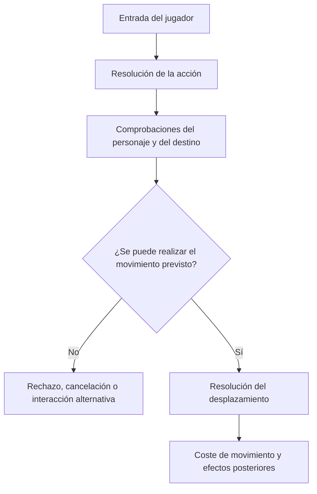
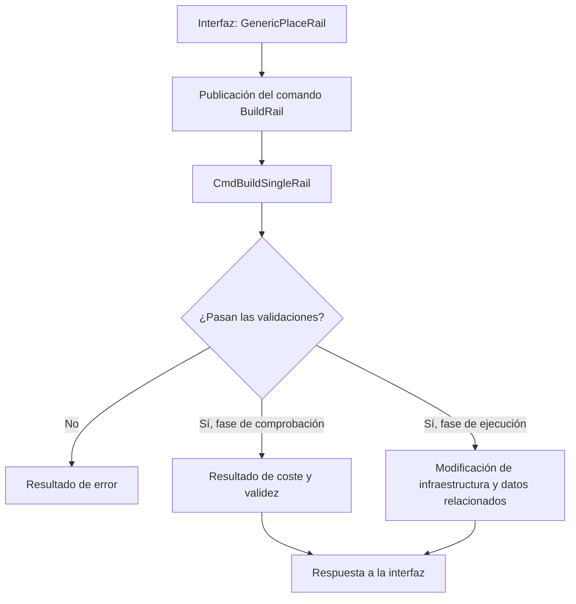
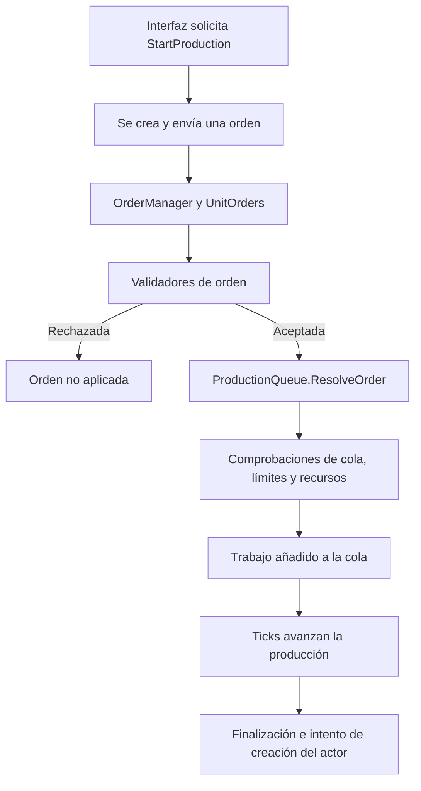

# 02-A — Auditoría técnica de proyectos de referencia

> **Estado:** preliminar · Investigación documental, no auditoría de ejecución  
> **Propósito:** registrar patrones de implementación observados en proyectos reales para orientar el futuro diseño del videojuego experimental.  
> **Regla de rigor:** distinguir siempre entre evidencia directa en código, cobertura de pruebas, hipótesis de diseño y cuestiones pendientes.

## 1. Relación con los documentos base

Este documento complementa, pero no reemplaza, los tres documentos conceptuales existentes:

- **01-A — Catálogo de géneros y formas de jugar**
- **01-B — Biblioteca de mecánicas**
- **01-C — Casos de estudio profundos**

Los documentos 01 describen el espacio de diseño y sus ejemplos. Este 02-A registra cómo ciertos sistemas concretos se implementan en código. La integración cruzada con los tres documentos queda pendiente hasta completar las trazas técnicas.

No se elige todavía motor, lenguaje, arquitectura definitiva ni estrategia de implementación.

## 2. Alcance y método

Se seleccionaron tres proyectos de código abierto que presentan problemas de simulación distintos:

1. **Cataclysm: Dark Days Ahead (DDA):** simulación contextual de acciones y movimiento.
2. **OpenTTD:** comandos de construcción y modificación del mundo.
3. **OpenRA:** procesamiento de órdenes y producción de unidades.

Método aplicado:
- Inspección de archivos fuente y pruebas localizadas.
- Reconstrucción de recorridos funcionales a partir de llamadas y tipos visibles.
- Registro de revisiones de código usadas para que los enlaces no dependan solo de ramas móviles.
- Separación explícita entre comportamiento implementado, pruebas encontradas y deducciones.
- No se afirma que el código haya sido compilado, ejecutado, perfilado ni sometido a pruebas propias.

### 2.1 Revisiones de trabajo

| Proyecto | Revisión usada | Repositorio |
|---|---|---|
| Cataclysm DDA | `0947a14bab4cf6b3243568cb78ac3e6a2a108e1d` | [CleverRaven/Cataclysm-DDA](https://github.com/CleverRaven/Cataclysm-DDA) |
| OpenTTD | `d48d693d7ff09b643846e23a5f033cf3582ab27f` | [OpenTTD/OpenTTD](https://github.com/OpenTTD/OpenTTD) |
| OpenRA | `e7e9e4ad270221d7fb9725b348c75504d48c1ebd` | [OpenRA/OpenRA](https://github.com/OpenRA/OpenRA) |

Estos identificadores son las referencias de trabajo de la inspección previa. Antes de declarar la auditoría cerrada, conviene verificar de nuevo que cada SHA corresponde a la revisión deseada y que todos los enlaces de archivos usan exactamente esa revisión.

---

## 3. Cataclysm DDA — Movimiento contextual

### 3.1 Archivos relevantes

- [`src/handle_action.cpp` en la revisión inspeccionada](https://github.com/CleverRaven/Cataclysm-DDA/blob/0947a14bab4cf6b3243568cb78ac3e6a2a108e1d/src/handle_action.cpp)
- [`src/avatar_action.cpp` en la revisión inspeccionada](https://github.com/CleverRaven/Cataclysm-DDA/blob/0947a14bab4cf6b3243568cb78ac3e6a2a108e1d/src/avatar_action.cpp)
- [`tests/move_cost_test.cpp` en la revisión inspeccionada](https://github.com/CleverRaven/Cataclysm-DDA/blob/0947a14bab4cf6b3243568cb78ac3e6a2a108e1d/tests/move_cost_test.cpp)
- [`src/game.h` en la rama actual](https://github.com/CleverRaven/Cataclysm-DDA/blob/master/src/game.h)
- [`src/game.cpp` en la rama actual](https://github.com/CleverRaven/Cataclysm-DDA/blob/master/src/game.cpp)
- [`src/savegame_json.cpp` en la rama actual](https://github.com/CleverRaven/Cataclysm-DDA/blob/master/src/savegame_json.cpp)
- [`doc/MODDING.md` en la rama actual](https://github.com/CleverRaven/Cataclysm-DDA/blob/master/doc/MODDING.md)

> Los enlaces que apuntan a `master` son referencias exploratorias móviles; no deben mezclarse con evidencia de la revisión fijada sin verificar el mismo contenido en el SHA.

### 3.2 Hallazgo preliminar

El movimiento no se reduce a sumar una dirección a la posición. La acción de movimiento consulta el contexto del personaje y del mundo, y puede relacionarse con estados del personaje, terreno, criaturas, restricciones y efectos secundarios.

Flujo conceptual preliminar:

El diagrama es una síntesis conceptual, no un trazado exhaustivo de todas las ramas del código. Queda pendiente confirmar en una única revisión el orden exacto de todas las comprobaciones, mutaciones de posición, consumo de puntos de movimiento y efectos posteriores.

### 3.3 Pruebas encontradas

En `tests/move_cost_test.cpp` hay pruebas de costes de movimiento en escenarios específicos y comprobaciones relacionadas con `avatar_action::move(...)` y los puntos de movimiento. Entre los casos inspeccionados aparecen valores como 100 para un coste base normalizado, 300 en un escenario con el personaje derribado, 116 sin calzado, y valores de patines dependientes del terreno (27 en pavimento y 167 en hierba en un escenario de carrera).

Estos valores pertenecen a los casos de prueba concretos; **no son constantes universales** del sistema. Esta prueba no demuestra por sí sola que todas las ramas de colisión, interacción o movimiento estén cubiertas.

### 3.4 Implicaciones para el proyecto

- Una acción de alto nivel puede coordinar estado, geometría, entidades, combate y tiempo.
- Conviene distinguir la intención de moverse de la resolución efectiva del desplazamiento.
- El coste de una acción debería analizarse por separado de la decisión de si la acción es válida.
- Una API genérica de movimiento no debería ocultar las reglas contextuales que necesita cada tipo de entidad.

### 3.5 Pendientes

- [ ] Confirmar SHA completo y enlaces de todos los archivos.
- [ ] Cerrar el recorrido de mutación de posición y efectos posteriores.
- [ ] Inspeccionar pruebas de obstáculos, criaturas, rampas y restricciones.
- [ ] Distinguir pruebas unitarias de coste de pruebas integradas de movimiento.
- [ ] Trazar serialización y restauración del estado relevante en la misma revisión.

---

## 4. OpenTTD — Comandos de construcción

### 4.1 Archivos relevantes

- [`src/rail_gui.cpp`](https://github.com/OpenTTD/OpenTTD/blob/d48d693d7ff09b643846e23a5f033cf3582ab27f/src/rail_gui.cpp)
- [`src/rail_cmd.cpp`](https://github.com/OpenTTD/OpenTTD/blob/d48d693d7ff09b643846e23a5f033cf3582ab27f/src/rail_cmd.cpp)
- [`src/command.cpp`](https://github.com/OpenTTD/OpenTTD/blob/d48d693d7ff09b643846e23a5f033cf3582ab27f/src/command.cpp)
- [`src/command_func.h`](https://github.com/OpenTTD/OpenTTD/blob/d48d693d7ff09b643846e23a5f033cf3582ab27f/src/command_func.h)
- [`CMakeLists.txt`](https://github.com/OpenTTD/OpenTTD/blob/master/CMakeLists.txt)

Los enlaces a los tres archivos de implementación usan la revisión de trabajo fijada. El enlace a `CMakeLists.txt` es exploratorio y móvil.

### 4.2 Hallazgo preliminar

La interfaz de construcción solicita la operación a través del sistema de comandos. La función `GenericPlaceRail()` publica una orden de construcción; `CmdBuildSingleRail()` centraliza reglas de validación y ejecución para el tramo de vía.

Entre las condiciones revisadas están propiedad, tipo y combinación de vías, pendiente, ocupación por vehículos, señales y obstáculos. Las modificaciones del mundo están condicionadas por `flags.Test(DoCommandFlag::Execute)` en las rutas correspondientes, separando comprobación y ejecución.

El diagrama resume el patrón y no pretende describir cada variante de ejecución, llamada anidada o resultado del sistema de comandos.

### 4.3 Implicaciones para el proyecto

- La interfaz puede expresar una intención sin duplicar todas las reglas del mundo.
- La lógica del comando puede actuar como autoridad sobre la validez de una operación.
- Un resultado explícito facilita comunicar éxito, coste o error a la interfaz.
- Separar comprobación y ejecución ayuda a reducir modificaciones accidentales durante consultas de validez.

Posible aplicación futura: construcción, transformación, comercio o interacción con objetos podrían usar operaciones explícitas. Antes de generalizar este patrón, habrá que evaluar si diferentes géneros comparten suficiente semántica para usar el mismo contrato.

### 4.4 Pruebas y pendientes

Se localizó infraestructura de pruebas y regresión en el repositorio, pero la búsqueda preliminar no identificó una prueba que cubra de extremo a extremo la construcción de una vía desde la interfaz hasta la modificación del mundo. Esto **no demuestra que tal prueba no exista**; significa que todavía no se localizó.

- [ ] Verificar SHA y enlaces de archivos de pruebas.
- [ ] Completar la ruta de publicación, ejecución y retorno del resultado.
- [ ] Buscar pruebas específicas de comandos de construcción de vía.
- [ ] Identificar pruebas de rechazo por propiedad, pendiente, ocupación y señales.
- [ ] Seguir el estado modificado hasta los mecanismos de guardado/carga.

---

## 5. OpenRA — Órdenes y cola de producción

### 5.1 Archivos relevantes

- [`OpenRA.Game/Network/Order.cs`](https://github.com/OpenRA/OpenRA/blob/e7e9e4ad270221d7fb9725b348c75504d48c1ebd/OpenRA.Game/Network/Order.cs)
- [`OpenRA.Game/Network/OrderManager.cs`](https://github.com/OpenRA/OpenRA/blob/e7e9e4ad270221d7fb9725b348c75504d48c1ebd/OpenRA.Game/Network/OrderManager.cs)
- [`OpenRA.Game/Network/UnitOrders.cs`](https://github.com/OpenRA/OpenRA/blob/e7e9e4ad270221d7fb9725b348c75504d48c1ebd/OpenRA.Game/Network/UnitOrders.cs)
- [`OpenRA.Game/World.cs`](https://github.com/OpenRA/OpenRA/blob/e7e9e4ad270221d7fb9725b348c75504d48c1ebd/OpenRA.Game/World.cs)
- [`OpenRA.Mods.Common/Traits/Player/ProductionQueue.cs`](https://github.com/OpenRA/OpenRA/blob/e7e9e4ad270221d7fb9725b348c75504d48c1ebd/OpenRA.Mods.Common/Traits/Player/ProductionQueue.cs)
- [`OpenRA.Mods.Common/Traits/World/ValidateOrder.cs`](https://github.com/OpenRA/OpenRA/blob/e7e9e4ad270221d7fb9725b348c75504d48c1ebd/OpenRA.Mods.Common/Traits/World/ValidateOrder.cs)

### 5.2 Hallazgo preliminar

La orden se procesa mediante `OrderManager` y `UnitOrders`. La resolución comprueba si el sujeto sigue siendo válido y si los validadores aceptan la orden; entonces la orden se deriva al actor correspondiente. `ProductionQueue.ResolveOrder()` procesa órdenes de producción y verifica cola, elemento construible, límites y condiciones de recursos según la configuración. El tick de la cola avanza el elemento en curso cuando no está pausado y hay producción habilitada.

Flujo conceptual:

Queda pendiente cerrar la ruta desde el control de interfaz exacto que crea la orden, así como la secuencia completa de finalización y creación para cada clase de producto.

### 5.3 Sincronización no equivale a persistencia

Que `ProductionQueue` implemente `ISync` no demuestra por sí solo que el estado de la cola se serialice y restaure en una partida guardada. Debe rastrearse la ruta concreta de guardado/carga y las interfaces o mecanismos de datos usados para ello.

| Concepto | Evidencia que hace falta |
|---|---|
| Orden procesada | Ruta de creación, validación y aplicación de la orden |
| Sincronización | Estado o hash usado para detectar divergencias entre simulaciones |
| Guardado | Código que escribe el estado de la cola |
| Restauración | Código que reconstruye la cola al cargar |
| Cobertura de pruebas | Test que verifica el comportamiento relevante |

### 5.4 Implicaciones para el proyecto

- Las órdenes separan intención de aplicación.
- Los validadores permiten rechazar acciones antes de alterar el estado.
- Una cola representa trabajo pendiente y progreso temporal, no solo una animación.
- Completar el tiempo de producción y lograr colocar la unidad en el mundo son estados distintos.
- Sincronización, serialización y restauración deben tratarse como responsabilidades separadas.

### 5.5 Pendientes

- [ ] Encontrar el origen exacto de la orden en la interfaz de producción.
- [ ] Trazar la finalización y la creación de actores para unidades y edificios.
- [ ] Rastrear la serialización y restauración real de la cola.
- [ ] Buscar pruebas de producción, bloqueo y guardado/carga.
- [ ] Verificar que la revisión fijada coincide con todas las rutas citadas.

---

## 6. Comparación transversal

| Dimensión | Cataclysm DDA | OpenTTD | OpenRA |
|---|---|---|---|
| Operación examinada | Movimiento contextual | Construcción de vías | Producción de unidades |
| Complejidad dominante | Estado del personaje y entorno | Validación de reglas y modificación del mapa | Órdenes, colas y progresión temporal |
| Frontera de decisión | Acción y movimiento | Sistema de comandos | Procesamiento de órdenes y traits |
| Costes/restricciones | Tiempo de movimiento, estados y terreno | Propiedad, geometría, ocupación y coste | Recursos, requisitos y límites |
| Pruebas específicas localizadas | Pruebas de costes; cobertura global incompleta | Infraestructura general; falta localizar test end-to-end | Falta localizar test end-to-end |
| Persistencia | Código de serialización localizado; ruta completa pendiente | Pendiente de trazar para la operación estudiada | Persistencia de la cola pendiente de confirmar |

### 6.1 Hipótesis de diseño, todavía no decisiones

1. El proyecto probablemente necesitará más de un patrón de ejecución de reglas.
2. Conviene distinguir intención, validación, mutación del estado y efectos posteriores.
3. Las mecánicas que comparten una interfaz visible no necesariamente comparten semántica interna.
4. Los subsistemas temporales —colas, turnos, acciones con coste, simulación continua— deben explicitar sus contratos.
5. Persistencia, sincronización y pruebas necesitan estrategias verificables por separado.

Estas hipótesis deberán contrastarse con otros proyectos y con los requisitos concretos del videojuego experimental.

---

## 7. Registro de evidencia

Usar estas categorías en las siguientes iteraciones:

- **Confirmado en código:** existe una ruta o condición visible en una revisión concreta.
- **Prueba localizada:** existe un test identificado; documentar qué afirma realmente.
- **Parcial:** se verificó una parte del recorrido, pero faltan ramas o componentes.
- **Hipótesis:** posible patrón transferible a nuestro proyecto, aún sin validar.
- **Pendiente:** evidencia que aún debe buscarse.
- **No encontrado:** no se localizó durante la búsqueda realizada; no equivale a afirmar que no existe.

## 8. Próxima iteración de investigación

Orden recomendado:

1. **Cataclysm DDA:** cerrar el orden de comprobaciones, coste, mutación de posición y efectos posteriores; ampliar la búsqueda de pruebas.
2. **OpenTTD:** cerrar publicación y ejecución de comandos, retorno de resultados, tests de construcción y persistencia del estado relevante.
3. **OpenRA:** rastrear UI → orden → validación → cola → finalización → creación; localizar serialización, restauración y tests.
4. Verificar SHA y permalinks antes de cerrar cada apartado.
5. Contrastar los hallazgos con 01-A, 01-B y 01-C, señalando confirmaciones, matices y contradicciones.
6. Solo después preparar una matriz de decisiones arquitectónicas basada en requisitos y evidencia.

## 9. Fuentes generales

- [Repositorio Cataclysm DDA](https://github.com/CleverRaven/Cataclysm-DDA)
- [Repositorio OpenTTD](https://github.com/OpenTTD/OpenTTD)
- [Repositorio OpenRA](https://github.com/OpenRA/OpenRA)
- [Documentación oficial de GitHub sobre contenidos de repositorios](https://docs.github.com/en/rest/repos/contents)

## 10. Advertencias de alcance

Este documento refleja una inspección estática preliminar y sus resultados deben revisarse antes de usarlos como base de decisiones costosas. No se han ejecutado builds, tests ni benchmarks propios. Los diagramas resumen flujos conceptuales; no sustituyen una traza de todas las ramas del código. La selección de tres proyectos tampoco permite generalizar automáticamente los patrones a todos los géneros o motores.

**Estado final de esta versión:** documentación inicial consolidada; auditoría técnica abierta; arquitectura del proyecto sin decidir.

---

## 11. Iteración de seguimiento — trazas funcionales ampliadas

> **Estado de esta iteración:** nuevas conexiones verificadas en código fuente de las revisiones indicadas. Las pruebas de extremo a extremo y la persistencia completa siguen abiertas.

### 11.1 Cataclysm DDA: de la acción al desplazamiento efectivo

En `avatar_action::move(...)`, el flujo inspeccionado incluye más que el cálculo inicial del destino:

- Algunas restricciones hacen que la acción termine sin desplazarse.
- El personaje puede cambiar de estado antes de resolver el destino.
- Una baldosa con rampa puede modificar el nivel vertical del destino.
- En el caso de minería automática, el personaje puede invocar la herramienta y diferir el movimiento hasta que la actividad termine.
- Más adelante, la acción delega el intento de desplazamiento a `g->walk_move(dest_loc, via_ramp)`.
- La ruta contiene lógica posterior al movimiento para actualizar visibilidad y modo seguro; también puede intentar revertir el desplazamiento si el jugador cancela una decisión de auto-observación.

En otra ruta de movimiento del mismo archivo, la mutación de posición se hace mediante `you.setpos(...)`; luego se actualiza el mapa, se despachan eventos de movimiento, se calcula el gasto de puntos de movimiento y se consume resistencia cuando corresponde. Esta evidencia confirma que hay responsabilidades de movimiento repartidas en más de una función; todavía no constituye una traza única y exhaustiva de todas las variantes.

**Conclusión ajustada:** `avatar_action::move` actúa como coordinador de la intención y de varias decisiones contextuales, mientras que `game::walk_move` participa en la resolución del desplazamiento ordinario. Para documentar el contrato completo aún hay que trazar la implementación de `walk_move`, sus validaciones de obstáculos/entidades y sus efectos secundarios.

Referencia fijada: [`avatar_action.cpp`](https://github.com/CleverRaven/Cataclysm-DDA/blob/0947a14bab4cf6b3243568cb78ac3e6a2a108e1d/src/avatar_action.cpp).

### 11.2 OpenTTD: UI → comando → prueba → ejecución → resultado

La ruta de construcción de vías ya tiene una conexión directa confirmada:

1. `GenericPlaceRail(...)` en `rail_gui.cpp` publica `Command<Commands::BuildRail>::Post(...)`.
2. La implementación de `CmdBuildSingleRail(...)` en `rail_cmd.cpp` valida parámetros, propiedad, compatibilidad de vías, combinaciones de tramos, presencia de trenes, pendientes y señales, entre otras condiciones.
3. Cuando la operación es válida, la función calcula los costes y ejecuta modificaciones del mundo solo cuando `flags.Test(DoCommandFlag::Execute)` está activo.
4. `command.cpp` contiene una fase de validación/prueba antes de la ejecución real en el flujo de comandos. `InternalExecuteValidateTestAndPrepExec(...)` puede detener la operación si la prueba falla, si solo se estima el coste o si no se cumplen las condiciones financieras; cuando procede, prepara el estado para la ejecución.
5. `InternalDoAfter(...)` separa el tratamiento del resultado de prueba del tratamiento posterior a la ejecución, incluido el cargo de dinero en el caso correspondiente.

Referencias:
- [`rail_gui.cpp`](https://github.com/OpenTTD/OpenTTD/blob/d48d693d7ff09b643846e23a5f033cf3582ab27f/src/rail_gui.cpp)
- [`rail_cmd.cpp`](https://github.com/OpenTTD/OpenTTD/blob/d48d693d7ff09b643846e23a5f033cf3582ab27f/src/rail_cmd.cpp)
- [`command.cpp`](https://github.com/OpenTTD/OpenTTD/blob/d48d693d7ff09b643846e23a5f033cf3582ab27f/src/command.cpp)

**Implicación:** la separación entre validar/estimar y ejecutar es un patrón particularmente útil para acciones que modifican un mundo persistente. Aun así, la prueba de comando no debe confundirse automáticamente con un test unitario: es parte del protocolo de ejecución del juego.

**Pendiente:** seguir el callback final y su presentación en la UI; localizar tests específicos de la construcción de vías y verificar cómo se persisten las modificaciones del mapa.

### 11.3 OpenRA: UI → orden → cola → trabajo temporal → finalización

La conexión de la interfaz con la cola quedó localizada en `ProductionPaletteWidget.cs`: al elegir un elemento construible, la UI consulta `BuildableItems()`, puede comprobar recursos iniciales, llama a `CanQueue(...)` y, si la cola acepta el pedido, publica `World.IssueOrder(Order.StartProduction(...))`.

En `ProductionQueue.ResolveOrder(...)`, la orden se comprueba de nuevo: la cola debe estar habilitada, el elemento debe pertenecer al tipo de cola, tiene que aparecer entre los elementos construibles y debe respetar los límites aplicables. El coste y el tiempo se calculan antes de crear el elemento de producción y añadirlo a la cola.

Durante los ticks, `TickInner(...)` avanza el primer elemento cuando existe trabajo y la producción no está pausada. La finalización programa una tarea al final del frame. Para unidades que no son edificios, esa tarea intenta `BuildUnit(unit)`; si no puede crearla, existe una ruta de notificación de bloqueo. Por tanto, **finalizar el progreso de producción y conseguir que la unidad aparezca en el mundo son etapas diferentes**.

Referencias:
- [`ProductionPaletteWidget.cs`](https://github.com/OpenRA/OpenRA/blob/e7e9e4ad270221d7fb9725b348c75504d48c1ebd/OpenRA.Mods.Common/Widgets/ProductionPaletteWidget.cs)
- [`ProductionQueue.cs`](https://github.com/OpenRA/OpenRA/blob/e7e9e4ad270221d7fb9725b348c75504d48c1ebd/OpenRA.Mods.Common/Traits/Player/ProductionQueue.cs)
- [`OrderManager.cs`](https://github.com/OpenRA/OpenRA/blob/e7e9e4ad270221d7fb9725b348c75504d48c1ebd/OpenRA.Game/Network/OrderManager.cs)

En la parte de red, `OrderManager.ProcessOrders()` procesa las órdenes asociadas a cada frame y envía un hash de sincronización del mundo mediante `World.SyncHash()` en el recorrido correspondiente. Esto respalda la distinción entre órdenes deterministas/sincronizadas y persistencia en un archivo de guardado.

**Pendiente:** seguir el sistema concreto de guardado/carga de la cola, el destino de edificios completados, los tests de producción y los casos de salida bloqueada.

### 11.4 Estado actualizado de la evidencia

| Pregunta | Estado |
|---|---|
| ¿La acción de movimiento puede producir efectos distintos del desplazamiento? | **Confirmado** en código; recorrido global parcial |
| ¿La construcción de vías separa comprobación y ejecución? | **Confirmado** en código |
| ¿La UI de OpenRA emite una orden de producción? | **Confirmado** en código |
| ¿La cola de OpenRA revalida y procesa la orden? | **Confirmado** en código |
| ¿La finalización garantiza que la unidad aparezca? | **No**; existe una ruta de creación que puede fallar |
| ¿`ISync` prueba que una cola se guarda y restaura? | **No**; se requiere trazar el mecanismo de guardado |
| ¿Se han localizado tests end-to-end para las tres rutas? | **Todavía no**; la búsqueda no permite afirmar que no existan |
| ¿Se ejecutaron builds o tests en esta auditoría? | **No** |

### 11.5 Próximas comprobaciones prioritarias

1. Seguir `game::walk_move` en Cataclysm DDA y enlazarlo con las pruebas existentes.
2. Identificar tests concretos de comandos de vía en OpenTTD y seguir el callback del resultado.
3. Encontrar el mecanismo real de guardado/carga de la cola de OpenRA y pruebas relacionadas.
4. Documentar por separado los resultados de búsqueda negativos como “no localizado”, nunca como “no existe”.

---

## 12. Iteración de seguimiento — validación, tests y límites de evidencia

### 12.1 Cataclysm DDA: validaciones internas de `game::walk_move`

Se inspeccionó la implementación de `game::walk_move(...)` en la revisión fijada de Cataclysm DDA. Entre las validaciones observadas directamente están:

- Si el personaje tiene la bandera de movimiento de fase, la función usa una ruta especial y coloca al personaje directamente.
- Los pasajes estrechos rechazan al personaje o a su montura si son demasiado grandes.
- El nivel de iluminación del destino puede bloquear el movimiento a personajes con una mutación específica, salvo condiciones que lo permiten.
- Una montura puede impedir el desplazamiento si no tiene energía o no puede ejecutar sus propios efectos de movimiento.
- La función continúa con comprobaciones relacionadas con vehículos y objetos agarrados; al final de la ruta exitosa hay efectos posteriores al movimiento mediante `on_move_effects()`.

La función contiene más lógica que estas condiciones; la lista es ilustrativa, no un inventario exhaustivo. La firma declara que devuelve `false` si el movimiento falla por cualquier razón, según el comentario en `game.h`.

Fuentes:
- [`game.cpp`, revisión fijada](https://github.com/CleverRaven/Cataclysm-DDA/blob/0947a14bab4cf6b3243568cb78ac3e6a2a108e1d/src/game.cpp)
- [`game.h`, revisión fijada](https://github.com/CleverRaven/Cataclysm-DDA/blob/0947a14bab4cf6b3243568cb78ac3e6a2a108e1d/src/game.h)

**Tests:** además de las pruebas de costes previamente documentadas, la búsqueda encontró un test de cardio que llama directamente a `g->walk_move(...)` y comprueba que el coste de movimiento disminuye y que la resistencia se consume durante la carrera. El test encontrado está en otra revisión de trabajo más reciente, por lo que debe mantenerse separado de la evidencia de la revisión fijada hasta verificar el mismo caso en ese SHA.

Fuente exploratoria: [`tests/cardio_test.cpp`](https://github.com/CleverRaven/Cataclysm-DDA/blob/4936af7e8b3a97f2abc67d24566c1b915fe3a415/tests/cardio_test.cpp).

**Lectura correcta:** existe al menos una prueba que ejercita el desplazamiento en un escenario de carrera y observa efectos temporales; no se ha demostrado cobertura integral de todas las restricciones de `walk_move`.

### 12.2 OpenTTD: el protocolo de comandos tiene fase de prueba

En la revisión fijada, `CmdBuildSingleRail(...)` valida el tipo de vía y la orientación; para una baldosa ferroviaria existente comprueba propiedad, compatibilidad, combinaciones de vías, presencia de trenes, pendientes y señales. Cuando la bandera de ejecución está activa, modifica los bits de vía y actualiza los contadores de infraestructura.

El sistema general de comandos tiene una fase explícita de prueba/preparación: `InternalExecuteValidateTestAndPrepExec(...)` puede detener el proceso si la prueba falla, si solo se está estimando el coste o si el dinero disponible no alcanza. Si procede, prepara el estado para la ejecución real. `InternalDoAfter(...)` trata de forma distinta los resultados de prueba y los de ejecución; en la ejecución normal puede descontar el coste a la empresa.

Fuentes:
- [`rail_cmd.cpp`](https://github.com/OpenTTD/OpenTTD/blob/d48d693d7ff09b643846e23a5f033cf3582ab27f/src/rail_cmd.cpp)
- [`command.cpp`](https://github.com/OpenTTD/OpenTTD/blob/d48d693d7ff09b643846e23a5f033cf3582ab27f/src/command.cpp)
- [`rail_gui.cpp`](https://github.com/OpenTTD/OpenTTD/blob/d48d693d7ff09b643846e23a5f033cf3582ab27f/src/rail_gui.cpp)

**Tests:** la búsqueda por símbolos y nombres relacionados no localizó una prueba específica de extremo a extremo para `CmdBuildSingleRail`. No debe inferirse que no existe. Sigue pendiente una búsqueda más amplia por el sistema de tests de OpenTTD y sus convenciones.

### 12.3 OpenRA: cola de producción y persistencia aún no cerrada

La inspección de `ProductionQueue.cs` confirma que `ProductionQueue` implementa `ISync` y que algunos campos tienen atributos `VerifySync`. Esto forma parte de la infraestructura de sincronización/verificación de estado; **no prueba por sí solo que el contenido completo de `Queue` se guarde y restaure**.

Se intentó localizar el mecanismo de guardado buscando símbolos de serialización y guardado en los archivos examinados, pero la búsqueda no fue suficiente para trazar el recorrido. Por lo tanto, la conclusión responsable sigue siendo **persistencia no confirmada en esta iteración**, no ausencia de persistencia.

La UI de producción está identificada en `ProductionPaletteWidget.cs`; la orden se procesa en `ProductionQueue.ResolveOrder(...)`; el progreso avanza desde `TickInner(...)`; y el trabajo completado puede intentar crear una unidad mediante `BuildUnit(...)`. La finalización y la creación en el mapa siguen siendo etapas distintas.

Fuentes:
- [`ProductionPaletteWidget.cs`](https://github.com/OpenRA/OpenRA/blob/e7e9e4ad270221d7fb9725b348c75504d48c1ebd/OpenRA.Mods.Common/Widgets/ProductionPaletteWidget.cs)
- [`ProductionQueue.cs`](https://github.com/OpenRA/OpenRA/blob/e7e9e4ad270221d7fb9725b348c75504d48c1ebd/OpenRA.Mods.Common/Traits/Player/ProductionQueue.cs)
- [`OrderManager.cs`](https://github.com/OpenRA/OpenRA/blob/e7e9e4ad270221d7fb9725b348c75504d48c1ebd/OpenRA.Game/Network/OrderManager.cs)

### 12.4 Matriz de avance

| Pregunta | Resultado actual | Confianza |
|---|---|---|
| ¿Qué valida `game::walk_move`? | Tamaño, luz en ciertas condiciones, montura, vehículos/objetos agarrados y más | Confirmado parcialmente en código |
| ¿Hay un test que invoque `walk_move`? | Sí, se encontró un test de cardio en otra revisión de trabajo | Confirmado en la revisión enlazada; falta alinear SHA |
| ¿OpenTTD separa validación de ejecución? | Sí, en el protocolo de comandos y en el comando de vía | Confirmado en código |
| ¿Se encontró test específico de construcción de vía? | No localizado por ahora | Búsqueda incompleta |
| ¿OpenRA sincroniza/verifica estado? | Sí, el gestor procesa órdenes por frame y calcula hash de sincronización | Confirmado en código |
| ¿La cola de OpenRA se guarda y restaura? | No se ha cerrado el recorrido | Pendiente |
| ¿Se ejecutaron tests propios? | No | Confirmado: no ejecutados |

### 12.5 Próximos pasos técnicos

1. Buscar tests de movimiento en la misma revisión fijada de Cataclysm DDA y enlazar cada test con la regla que comprueba.
2. Revisar la estructura de tests de OpenTTD y buscar casos de construcción de vía por el comportamiento probado, no solo por el nombre de la función.
3. Seguir el sistema de guardado/carga de OpenRA desde el punto de entrada del guardado hasta la reconstrucción de actores/traits; comprobar si la cola se reconstruye, se serializa o se deriva de otro estado.
4. Mantener diferenciados los SHA fijados de los resultados de búsqueda en ramas más recientes.

---

## 13. Triangulación de fuentes — guardado y carga en OpenRA

> **Método aplicado:** contrastar implementación, contratos de interfaces, documentación oficial y registro histórico de la implementación. Las fuentes no son todas independientes, pero aportan tipos distintos de evidencia.

### 13.1 Hallazgo principal: OpenRA reconstruye una partida guardada mediante órdenes

La evidencia más directa es la descripción de la PR [#16411 — Implement game save plumbing and enable for missions](https://github.com/OpenRA/OpenRA/pull/16411). La descripción explica que el guardado/carga se implementó mediante **resimulación de órdenes** y que, para restaurar ciertos datos que no se recuperan solo de las órdenes, los traits pueden aportar datos adicionales al guardar y recibirlos al cargar. La PR también indica que chat y órdenes inmediatas no se guardan en ese mecanismo, y que las partidas de campaña fueron el caso habilitado inicialmente.

Esto ajusta la hipótesis previa: no debe suponerse que OpenRA guarda una fotografía serializada completa de cada campo de cada sistema. En el mecanismo descrito, la simulación vuelve a procesar órdenes para reconstruir el estado y existe un canal adicional para datos específicos de traits.

### 13.2 Triangulación en el código fuente

**Fuente A — Contrato de datos adicionales:** en `OpenRA.Game/Traits/TraitsInterfaces.cs`, `IGameSaveTraitData` declara dos operaciones:
- `IssueTraitData(Actor self)`: devuelve nodos de datos que se pueden adjuntar al guardado.
- `ResolveTraitData(Actor self, MiniYaml data)`: restaura esos datos al completar la carga.

El mismo archivo define notificaciones `INotifyGameSaved` y `INotifyGameLoaded`, lo que confirma que el ciclo de guardado/carga tiene puntos de extensión para los traits.

Fuente: [`TraitsInterfaces.cs`, revisión fijada](https://github.com/OpenRA/OpenRA/blob/e7e9e4ad270221d7fb9725b348c75504d48c1ebd/OpenRA.Game/Traits/TraitsInterfaces.cs).

**Fuente B — Restauración al terminar la carga:** en `OpenRA.Game/World.cs`, el flujo de ticks comprueba la transición desde `IsLoadingGameSave`. Al finalizar, recorre los datos de traits almacenados, llama a `ResolveTraitData(...)`, limpia esos datos y notifica `INotifyGameLoaded`. Esto verifica en el código el contrato de restauración declarado por la interfaz.

Fuente: [`World.cs`, revisión fijada](https://github.com/OpenRA/OpenRA/blob/e7e9e4ad270221d7fb9725b348c75504d48c1ebd/OpenRA.Game/World.cs).

**Fuente C — Ejemplos concretos:** `GameSaveViewportManager` implementa `IGameSaveTraitData` para restaurar el centro de la cámara y, en una ruta de espectador, el jugador que se está observando. `Selection` también implementa el contrato para guardar y recuperar la selección de actores. Son ejemplos de estado de interfaz que no conviene confundir con la simulación determinista del mundo.

Fuentes:
- [`GameSaveViewportManager.cs`](https://github.com/OpenRA/OpenRA/blob/e7e9e4ad270221d7fb9725b348c75504d48c1ebd/OpenRA.Mods.Common/Traits/Player/GameSaveViewportManager.cs)
- [`Selection.cs`](https://github.com/OpenRA/OpenRA/blob/e7e9e4ad270221d7fb9725b348c75504d48c1ebd/OpenRA.Mods.Common/Traits/World/Selection.cs)

### 13.3 ¿Qué implica para ProductionQueue?

En la revisión fijada, `ProductionQueue` implementa `ISync` y marca algunos campos, como `Enabled` e `IsValidFaction`, con `[VerifySync]`. La declaración de la clase **no** incluye `IGameSaveTraitData`, y el campo `Queue` no aparece marcado en los fragmentos examinados como un bloque de datos de guardado explícito.

La interpretación prudente es:

- La cola participa en la infraestructura de sincronización/verificación del estado.
- No se encontró evidencia de que la cola serialice directamente su contenido mediante `IGameSaveTraitData`.
- Dado que la partida se reconstruye mediante resimulación de órdenes, es plausible que la cola se regenere como efecto de volver a procesar las órdenes de producción; sin embargo, todavía no se ha trazado el recorrido exacto de `StartProduction` durante la restauración para confirmar qué parte del estado se reconstruye y en qué momento.
- Por tanto, **no afirmar que la cola no se guarda**, ni afirmar todavía que su contenido se reconstruye íntegramente por órdenes. La implementación general está confirmada; el comportamiento específico de la cola queda parcialmente demostrado.

Fuente de implementación: [`ProductionQueue.cs`, revisión fijada](https://github.com/OpenRA/OpenRA/blob/e7e9e4ad270221d7fb9725b348c75504d48c1ebd/OpenRA.Mods.Common/Traits/Player/ProductionQueue.cs).

### 13.4 Triangulación documental e histórica

La referencia oficial de traits de OpenRA describe `ProductionQueue` como el trait que permite producir unidades o construir edificios y explica que distintas estructuras pueden tener colas separadas. Esta documentación valida el papel funcional del componente, pero no documenta el mecanismo interno de persistencia.

Fuente: [documentación oficial de traits: ProductionQueue](https://docs.openra.net/en/release/traits/).

La issue histórica [#2743 — Save Game Support](https://github.com/OpenRA/OpenRA/issues/2743) documenta el objetivo inicial del soporte de guardado: guardar para reproducir desincronizaciones, reanudar partidas y continuar misiones. La PR #16411 es más específica sobre el mecanismo implementado. Son fuentes históricas del mismo desarrollo, no confirmaciones independientes del código actual.

### 13.5 Estado de la conclusión

| Afirmación | Evidencia | Estado |
|---|---|---|
| El mecanismo de guardado de OpenRA usa resimulación de órdenes | Descripción de PR #16411 | Confirmado por registro de implementación |
| Los traits pueden aportar datos adicionales al guardado y restaurarlos | Interfaz + implementación de `World` + traits concretos | Confirmado por varias piezas de código |
| `ISync` por sí solo significa que un campo se serializa en un guardado | No respaldado; los contratos son distintos | Rechazado |
| `ProductionQueue` implementa `IGameSaveTraitData` en la revisión estudiada | La declaración de clase no lo incluye | No |
| La cola completa se reconstruye íntegramente mediante órdenes al cargar | No se trazó aún la restauración de órdenes de producción | Pendiente |
| Se localizaron tests automatizados específicos de round-trip de guardado de ProductionQueue | La búsqueda por símbolos no los encontró | No localizado; no equivale a inexistente |

### 13.6 Siguiente comprobación

Para cerrar esta pregunta se necesita seguir el código de lectura del archivo de guardado hasta el mecanismo de reproducción de órdenes y verificar si los pedidos de producción anteriores al punto guardado se vuelven a ejecutar. Después hay que identificar qué estado de la cola queda reconstruido por esa vía y si existe una prueba automatizada que compare el estado antes y después de guardar/cargar.

---

## 14. Protocolo de triangulación para futuras conclusiones

Para cada hallazgo importante se registrarán, cuando estén disponibles:

1. **Implementación:** archivo, símbolo y revisión.
2. **Invocador o consumidor:** cómo entra y sale la operación del subsistema.
3. **Prueba automatizada:** test concreto y qué afirma realmente.
4. **Documentación oficial:** contrato funcional declarado.
5. **Historial de desarrollo:** issue/PR que explique la intención o los límites conocidos.
6. **Resultado de triangulación:** qué se confirma, qué sigue siendo inferencia y qué no se ha encontrado.

No se exigirá que cada hallazgo tenga cinco fuentes si el proyecto no las ofrece. En esos casos se documentará explícitamente la limitación y se evitará presentar una inferencia como hecho confirmado.

---

## 15. OpenRA — cierre parcial del recorrido de guardado y restauración

### 15.1 Qué contiene realmente el archivo de guardado

La inspección de `OpenRA.Game/Network/GameSave.cs` confirma que el archivo no es simplemente una instantánea serializada de todos los actores y traits. El formato contiene:

- Una secuencia de órdenes con información de frame y cliente.
- Metadatos, incluido el último frame con órdenes y el último frame con hash de sincronización.
- Un paquete de hash para validar la restauración.
- Configuración global y datos de las plazas/clientes de la partida.
- Un bloque de datos adicionales aportados por traits.
- Información de generación de mapa en revisiones que la incluyen.

El constructor `GameSave(string filepath)` lee los metadatos y los datos adicionales, y recupera el flujo de órdenes guardado. `Save(string path)` escribe el flujo de órdenes y luego los metadatos y datos de traits. `ParseOrders(...)` vuelve a emitir primero los datos de traits, reproduce las órdenes por frame y cliente y al final emite el hash guardado para validar la restauración.

Fuente primaria: [`GameSave.cs`, revisión fijada](https://github.com/OpenRA/OpenRA/blob/e7e9e4ad270221d7fb9725b348c75504d48c1ebd/OpenRA.Game/Network/GameSave.cs).

### 15.2 Ruta de restauración y datos de traits

La interfaz `IGameSaveTraitData` permite a un trait producir datos complementarios y recuperarlos después. `World.Tick()` comprueba cuándo termina la fase `IsLoadingGameSave`, aplica los datos guardados a los traits correspondientes mediante `ResolveTraitData(...)`, limpia el búfer temporal y emite las notificaciones `INotifyGameLoaded`.

Fuente: [`World.cs`, revisión fijada](https://github.com/OpenRA/OpenRA/blob/e7e9e4ad270221d7fb9725b348c75504d48c1ebd/OpenRA.Game/World.cs).

La documentación de implementación de la [PR #16411](https://github.com/OpenRA/OpenRA/pull/16411) coincide con el código: el estado principal se reconstruye mediante resimulación de órdenes; los datos adicionales de traits sirven para restaurar información que no se recupera solo de las órdenes, como la cámara o los grupos de selección. La PR señala también que se excluyen las órdenes inmediatas y el chat del registro reproducido.

Como confirmación pública del resultado funcional, el anuncio oficial del playtest de agosto de 2019 indica que las misiones y partidas de escaramuza podían guardarse y reiniciarse después. Un anuncio de octubre de 2019 menciona correcciones de errores de guardado/carga, evidencia histórica de que el mecanismo necesitó iteración y no garantía de que todas las versiones posteriores carezcan de problemas.
- [Anuncio oficial del playtest 20190825](https://www.openra.net/news/playtest-20190825/)
- [Anuncio oficial del playtest 20191021](https://www.openra.net/news/playtest-20191021/)

### 15.3 ¿La cola de producción se reconstruye al cargar?

La nueva evidencia hace más plausible que la cola se reconstruya a través de las órdenes originales de producción, porque `GameSave` reproduce el historial de órdenes que forma parte de la simulación. Sin embargo, en esta iteración no se siguió de forma completa el tratamiento de `StartProduction` durante la reproducción ni se comprobó el estado exacto de progreso de cada elemento tras restaurar.

Por tanto, la conclusión se actualiza así:

- **Confirmado:** el mecanismo principal reproduce órdenes por frame para reconstruir la simulación.
- **Confirmado:** existe un canal adicional de datos específicos para traits.
- **Inferencia razonable, no cerrada:** la cola puede reconstruirse al reproducir órdenes de producción.
- **Pendiente:** demostrar qué pasa con el progreso parcial, pagos, orden de la cola, pausa y estados de bloqueo tras cargar una partida guardada.
- **No confirmado:** que la cola completa se serialice como una instantánea directa.

### 15.4 Triangulación de pruebas y comportamiento publicado

Se realizaron búsquedas en el código y en los registros del repositorio por términos relacionados con `GameSave`, `LoadGame`, `ProductionQueue` y pruebas de guardado/carga. No se localizó un test automatizado dedicado a un ciclo de guardar/cargar de `ProductionQueue` en la revisión estudiada. Tampoco se identificó un archivo de pruebas añadido en la PR #16411 entre sus archivos modificados.

Esta es una conclusión acotada: **no se localizó ese test en la búsqueda realizada**. No demuestra que el proyecto carezca de pruebas indirectas, pruebas manuales, pruebas de integración externas o tests añadidos en otras revisiones.

La issue histórica [#18255 — Loading saved games is slow on custom missions](https://github.com/OpenRA/OpenRA/issues/18255) describe un problema de rendimiento observado al cargar partidas de misiones personalizadas. Sirve como evidencia de experiencia operativa y limitaciones prácticas del enfoque, pero no es una prueba automatizada ni demuestra por sí sola un defecto en la restauración de la cola.

### 15.5 Matriz de confianza revisada

| Afirmación | Evidencia cruzada | Estado |
|---|---|---|
| El guardado contiene órdenes registradas y metadatos | Implementación de `GameSave.Save` y constructor de lectura | Confirmado |
| La restauración reproduce órdenes por frame | `GameSave.ParseOrders` + descripción de PR #16411 | Confirmado |
| El hash guardado se usa para validar la restauración | Código de `ParseOrders` + metadatos del archivo | Confirmado |
| Traits pueden aportar/restaurar datos complementarios | Interfaz, `World.Tick`, traits de cámara/selección | Confirmado |
| Toda la partida se guarda como snapshot de todos los campos | Contradice el mecanismo observado | No |
| `ProductionQueue` se restaura íntegramente a partir de órdenes | No se trazó el caso completo | Parcial / pendiente |
| Existe un test específico de round-trip para ProductionQueue | No localizado en las búsquedas y revisión examinadas | No localizado |
| El mecanismo se ha usado en partidas reales | Anuncios oficiales de playtests y reportes de usuarios | Confirmado a nivel de función publicada; no equivale a cobertura de test |

### 15.6 Conclusión de diseño provisional

OpenRA muestra una estrategia de persistencia basada en **reconstrucción determinista más datos complementarios selectivos**, en vez de serializar necesariamente todo el estado vivo. Esto puede reducir la duplicación de lógica de restauración, pero impone requisitos fuertes: las órdenes deben poder reproducirse de forma consistente, el orden de eventos importa y los componentes que mantienen estado no derivable de órdenes necesitan un contrato explícito de guardado.

No trasladar automáticamente este patrón al proyecto. Debe compararse con el coste de resimulación, la compatibilidad entre versiones, la aleatoriedad, los efectos externos y las mecánicas que requieren restauración exacta e inmediata.

**Estado de la auditoría OpenRA:** mecanismo general de guardado/carga confirmado con varias fuentes; persistencia específica de ProductionQueue y sus tests aún sin cerrar.

---

## 16. Seguimiento de la triangulación — fuentes oficiales externas y conclusión de OpenRA

Se contrastó la implementación con fuentes publicadas por el propio proyecto:

- El anuncio oficial del playtest [20190825](https://www.openra.net/news/playtest-20190825/) anuncia soporte de guardado y carga y especifica que misiones y partidas de escaramuza podían guardarse y reanudarse.
- El changelog histórico de OpenRA recoge en el release 20191117 la incorporación de soporte de guardado/carga para misiones y escaramuzas y enumera los PR asociados.
- La PR [#16411](https://github.com/OpenRA/OpenRA/pull/16411) describe el diseño basado en resimulación de órdenes y datos adicionales de traits.
- El código de [`GameSave.cs`](https://github.com/OpenRA/OpenRA/blob/e7e9e4ad270221d7fb9725b348c75504d48c1ebd/OpenRA.Game/Network/GameSave.cs) implementa el archivo, la lectura de órdenes y metadatos, la reproducción ordenada de órdenes y la emisión del hash para validar la restauración.
- [`World.cs`](https://github.com/OpenRA/OpenRA/blob/e7e9e4ad270221d7fb9725b348c75504d48c1ebd/OpenRA.Game/World.cs) aplica los datos complementarios de traits al finalizar la restauración.

Estas fuentes confirman el mecanismo general y su disponibilidad en versiones publicadas. No son cinco validaciones independientes: la PR, el código y los anuncios pertenecen al mismo proyecto y describen etapas relacionadas del mismo desarrollo.

### Conclusión refinada sobre ProductionQueue

La cola de producción se procesa mediante órdenes y ticks; el guardado reproduce el historial de órdenes. Es razonable esperar que las órdenes de producción reconstruyan buena parte del estado de la cola, pero no se ha demostrado el round-trip de todos sus estados.

En concreto, sigue pendiente verificar mediante el recorrido exacto y/o una prueba:
- progreso parcial de una unidad en producción;
- recursos cobrados y su consistencia tras la reproducción;
- posición relativa de elementos en la cola;
- pausas, bloqueos y límites;
- estado cuando la producción terminó pero no se pudo colocar la unidad.

No se localizó un test automatizado dedicado a guardar/cargar una `ProductionQueue` en la búsqueda realizada ni en los archivos cambiados por la PR #16411. Esto es “no localizado”, no una afirmación de inexistencia.

### Estado de la fase

- **Guardado/carga general de OpenRA:** confirmado con código, PR, changelog y anuncio oficial.
- **Persistencia de datos complementarios de traits:** confirmada en interfaz y flujo de restauración.
- **Reconstrucción específica y completa de ProductionQueue:** pendiente de verificación.
- **Test automatizado de round-trip de ProductionQueue:** no localizado.
- **Build o test ejecutado durante esta investigación:** no.

---

## 17. Auditoría de pruebas — primera pasada comparativa

> **Estado:** evidencia documental añadida desde las revisiones de trabajo fijadas. No se ejecutaron builds ni tests propios. La búsqueda de tests específicos es acotada: “no localizado” no equivale a “no existe”.

### 17.1 Cataclysm DDA: tests de coste y movimiento efectivo

Fuentes fijadas:
- [`tests/move_cost_test.cpp`](https://github.com/CleverRaven/Cataclysm-DDA/blob/0947a14bab4cf6b3243568cb78ac3e6a2a108e1d/tests/move_cost_test.cpp)
- [`tests/cardio_test.cpp`](https://github.com/CleverRaven/Cataclysm-DDA/blob/0947a14bab4cf6b3243568cb78ac3e6a2a108e1d/tests/cardio_test.cpp)
- [`src/game.h`](https://github.com/CleverRaven/Cataclysm-DDA/blob/0947a14bab4cf6b3243568cb78ac3e6a2a108e1d/src/game.h)

**Prueba localizada — `move_cost_test.cpp`:** cubre explícitamente el cálculo de coste de movimiento con condiciones como estar derribado, calzado, mutaciones, modo de movimiento y terreno. Los casos observados incluyen:
- derribado: coste de carrera 100 → 300, y valores proporcionales en otras bases;
- sin calzado: 100 → 116;
- patines en línea sobre pavimento durante la carrera: 27;
- patines en línea sobre hierba: 167;
- otros tipos de patines tienen valores diferenciados según el terreno.

El propio archivo identifica como función central de esta batería `Character::run_cost`. Por tanto, estos casos verifican principalmente el **cálculo del coste**, no la totalidad de la acción de moverse ni todas sus consecuencias.

**Prueba localizada — `cardio_test.cpp`:** en la misma revisión fijada, el helper `running_steps(...)` llama a `g->walk_move(...)` alternando entre dos baldosas y comprueba que:
- el personaje termina en la posición esperada en cada paso;
- el movimiento reduce los puntos disponibles;
- al agotarse los puntos, avanza el turno y se actualiza el cuerpo;
- la resistencia disminuye en los pasos observados;
- el ciclo termina al dejar de poder correr o alcanzar un límite defensivo.

Esto es evidencia más integrada que un test de coste aislado: ejecuta la ruta de movimiento real y observa posición, puntos de movimiento y resistencia. No demuestra, por sí solo, cobertura exhaustiva de colisiones, criaturas, rampas, obstáculos o todas las ramas de `walk_move`.

**Evaluación:** cobertura localizada tanto de reglas de coste como de un recorrido real de carrera y gasto de resistencia. La cobertura integral del movimiento sigue siendo **parcial**; no se calculó cobertura de líneas/ramas ni se ejecutó la suite.

### 17.2 OpenTTD: regresión automatizada mediante scripts y resultados esperados

Fuentes fijadas:
- [`regression/regression/main.nut`](https://github.com/OpenTTD/OpenTTD/blob/d48d693d7ff09b643846e23a5f033cf3582ab27f/regression/regression/main.nut)
- [`regression/regression/CMakeLists.txt`](https://github.com/OpenTTD/OpenTTD/blob/d48d693d7ff09b643846e23a5f033cf3582ab27f/regression/regression/CMakeLists.txt)
- [`cmake/scripts/Regression.cmake`](https://github.com/OpenTTD/OpenTTD/blob/d48d693d7ff09b643846e23a5f033cf3582ab27f/cmake/scripts/Regression.cmake)
- [`src/rail_cmd.cpp`](https://github.com/OpenTTD/OpenTTD/blob/d48d693d7ff09b643846e23a5f033cf3582ab27f/src/rail_cmd.cpp)

**Prueba localizada — regresión de API:** `Regression::Rail()` en `main.nut` ejecuta una secuencia de operaciones de la API de IA: construir y quitar tramos de vía, construir y quitar señales, consultar tipos de señal, construir y eliminar vías en varias posiciones, y consultar si las baldosas conservan el tipo de transporte esperado. También cubre operaciones relacionadas con depósitos, estaciones y puntos de ruta.

La infraestructura CMake declara entradas del caso de regresión —incluyendo script, resultados esperados y partida de prueba—; `Regression.cmake` compara el resultado producido con el archivo `result.txt`. Esto acredita una estrategia de **regresión por salida determinista esperada**, además de una secuencia de operaciones que observa cambios mediante la API.

**Límite importante:** esta evidencia prueba la superficie observable de la API de IA y la consistencia de su salida, no constituye una prueba unitaria directa de cada rama interna de `CmdBuildSingleRail`, ni demuestra que cada rechazo por propiedad, pendiente, vehículo, señal u obstáculo tenga un caso dedicado. No se localizó en esta pasada una prueba específica de extremo a extremo que vincule la interfaz gráfica con el comando interno y todas sus consecuencias.

**Evaluación:** hay pruebas de regresión funcionales de construcción de vías a través de la API; la cobertura detallada de validaciones internas queda **parcial / pendiente**.

### 17.3 OpenRA: proyecto NUnit y pruebas de órdenes, pero no test específico localizado para la cola

Fuentes fijadas:
- [`OpenRA.Test/OpenRA.Test.csproj`](https://github.com/OpenRA/OpenRA/blob/e7e9e4ad270221d7fb9725b348c75504d48c1ebd/OpenRA.Test/OpenRA.Test.csproj)
- [`OpenRA.Test/OpenRA.Game/OrderTest.cs`](https://github.com/OpenRA/OpenRA/blob/e7e9e4ad270221d7fb9725b348c75504d48c1ebd/OpenRA.Test/OpenRA.Game/OrderTest.cs)
- [`OpenRA.Game/Network/GameSave.cs`](https://github.com/OpenRA/OpenRA/blob/e7e9e4ad270221d7fb9725b348c75504d48c1ebd/OpenRA.Game/Network/GameSave.cs)
- [`OpenRA.Mods.Common/Traits/Player/ProductionQueue.cs`](https://github.com/OpenRA/OpenRA/blob/e7e9e4ad270221d7fb9725b348c75504d48c1ebd/OpenRA.Mods.Common/Traits/Player/ProductionQueue.cs)

El proyecto `OpenRA.Test` referencia Microsoft.NET.Test.Sdk y NUnit. Se localizó `OrderTest.cs`, que contiene pruebas relacionadas con el round-trip de órdenes serializadas. Esto demuestra que hay tests automatizados para ciertos contratos de órdenes; **no** demuestra que se verifique toda la aplicación de órdenes en el mundo de juego.

En la búsqueda acotada por nombres y contenido no se localizó un test específico de round-trip de guardado/carga de partida ni un test dedicado a `ProductionQueue` que verifique inicio, progreso parcial, pausa, pago, bloqueo de salida y restauración. Este resultado se registra como **no localizado en la búsqueda realizada**, no como prueba de inexistencia. La presencia de `ISync` en `ProductionQueue` sigue sin ser evidencia suficiente de persistencia en partidas guardadas.

**Evaluación:** pruebas unitarias de contratos de órdenes confirmadas; pruebas específicas de persistencia de partida y ciclo de vida de producción **pendientes de localizar o verificar**.

### 17.4 Comparación de lo que prueban realmente

| Proyecto | Evidencia automatizada localizada | Qué comprueba directamente | Límite de la evidencia |
|---|---|---|---|
| Cataclysm DDA | Tests de coste y helper que ejecuta `walk_move` | Costes concretos; posición, puntos de movimiento y resistencia durante carrera | No demuestra cobertura exhaustiva de obstáculos y ramas de movimiento |
| OpenTTD | Script de regresión de API con resultado esperado | Secuencias de construcción/eliminación de vías, señales y consultas posteriores | No cubre necesariamente cada rama interna del comando ni el recorrido de interfaz gráfica |
| OpenRA | NUnit y `OrderTest.cs` | Round-trip de órdenes serializadas en los casos definidos por el test | No se localizó test específico para guardado/carga de partida o restauración de `ProductionQueue` |

### 17.5 Lecciones metodológicas para el videojuego experimental

1. **Probar invariantes y resultados observables:** no limitarse a comprobar que una función devuelve éxito; verificar posición, recursos, tiempos, entidades y estado resultante.
2. **Separar niveles de prueba:** test unitario de fórmula/regla, test integrado del flujo real y test de regresión de secuencias completas responden preguntas distintas.
3. **Usar resultados esperados reproducibles cuando sea apropiado:** el patrón de OpenTTD puede ayudar a detectar cambios involuntarios en comportamientos públicos.
4. **Probar serialización por round-trip y por comportamiento:** que una orden pueda serializarse no demuestra que el mundo restaurado sea equivalente; que una cola se sincronice tampoco demuestra que se guarde correctamente.
5. **Registrar los límites:** cada test debe vincularse con la regla y el estado que observa, y la ausencia de un test localizado debe permanecer como incertidumbre.

### 17.6 Pendientes de la auditoría de tests

- [ ] Cataclysm DDA: ampliar búsqueda de tests de obstáculos, colisiones, criaturas y rampas en la revisión fijada.
- [ ] OpenTTD: rastrear si hay regresiones que prueben fallos de construcción por propiedad, pendientes, vehículos, señales y obstáculos.
- [ ] OpenRA: inspeccionar el contenido completo de `OrderTest.cs` y ampliar búsqueda de pruebas indirectas de carga de partidas y producción.
- [ ] No declarar cobertura total de ninguno de los tres proyectos sin resultados de cobertura o un inventario exhaustivo de tests.
- [ ] No afirmar ejecución de tests: esta iteración fue documental y estática.

### 17.7 Triangulación externa adicional — OpenRA y pruebas de sistemas de juego

Como contraste con la inspección estática, la discusión pública del [PR #22142 de OpenRA](https://github.com/OpenRA/OpenRA/pull/22142) contiene una conversación de octubre-noviembre de 2025 sobre una corrección de `ProductionQueue`. En ella, un participante pregunta cómo probar traits y propone añadir pruebas de producción; una respuesta del proyecto señala que no cuentan con pruebas unitarias adecuadas para sistemas dentro del juego y que sus tests se concentran más en sistemas técnicos y validaciones de YAML. La conversación también pide acompañar cambios de comportamiento con casos de prueba.

Esta fuente externa respalda —para esa discusión y ese momento— la cautela de no asumir que el proyecto tiene pruebas unitarias de todas sus mecánicas de juego. No debe extrapolarse a cada subsistema ni a todas las revisiones posteriores: es evidencia de una conversación de desarrollo concreta, no un inventario completo de cobertura. La revisión del código fijada en este documento sigue siendo la base para describir el comportamiento de `ProductionQueue`.

Fuente adicional: [PR #22142 — Encapsulates StartProduction order to fix infinite production bug](https://github.com/OpenRA/OpenRA/pull/22142).
